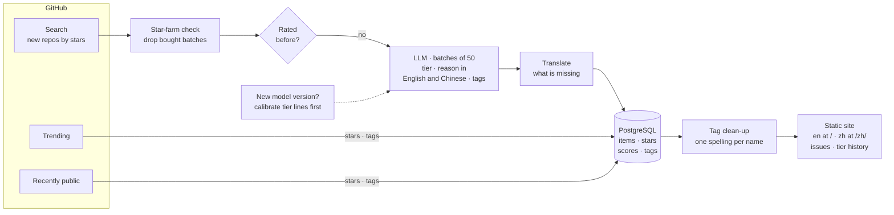
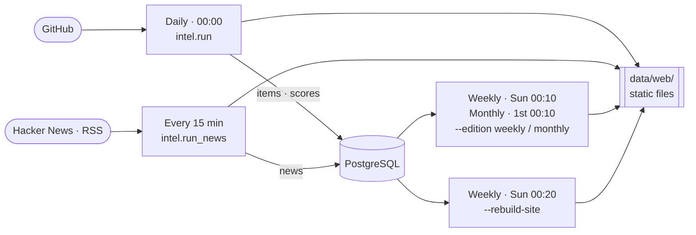

<p align="center"></p>

<h1 align="center">tierlist</h1>

<p align="center"><i>Hidden gems, rated before they trend.</i></p>

<p align="center"><a href="https://tierlist.tech">tierlist.tech</a> · English · <a href="./README.zh.md">中文</a></p>

The engine behind [tierlist.tech](https://tierlist.tech): a daily radar for new
open-source projects. It finds repositories in their first 72 hours, before they
reach the usual trending lists, has an LLM judge each one, and publishes the
result as a static site with daily, weekly and monthly issues.

Collection began on 2026-08-23. Every issue since then is kept and stays
readable in the archive.

Ratings come from **DeepSeek V4.1 Flash**, called through DeepSeek's own API
as `deepseek-flash`. Each score records the model version that made it, so a
change of model is visible in the data and gets its own tier lines (step 3
below). Any OpenAI-compatible endpoint can stand in;
[docs/self-hosting.md](./docs/self-hosting.md) shows how.

## How it works

The daily sweep, from GitHub to the published page:



1. **Collect.** GitHub search returns new repositories by stars. GitHub
   Trending and recently public repositories are stored for their star
   series and get topic tags, which feed the star-gain boards; they are not
   rated. Every item's star count is snapshotted on every sweep.
2. **Filter.** One free rule runs before any LLM call: star-farm batches (many
   repositories at the same star count created within minutes) are dropped.
   Every other new repository is rated.
3. **Calibrate, when the model changes.** Tier lines are kept per model
   version. A version the store has not seen first rescores the last 30 days
   apart from the published scores, and its lines are the same percentiles of
   those scores, so the share of each tier stays put.
4. **Rate.** The LLM rates the day's unrated repositories in requests of 50.
   The rubric in `intel/rubrics/dev_tools.yaml` scores four dimensions and
   asks for a one-line reason in English and Chinese; the weighted score
   becomes a tier from S to D, and only the tier is published. Topic tags come
   from the closed vocabulary in `intel/rubrics/tags.yaml`.
5. **Translate.** A reason the model wrote without English, and a
   repository's own description written in Chinese, Japanese, Korean or
   Cyrillic, get an English line, so the English site reads in English.
6. **Clean up tags.** Aliases fold synonyms onto one tag, and names spelled
   two ways (`marvelrivals`, `marvel-rivals`) are merged onto one.
7. **Publish.** `intel/deliver/` writes the static site (English at the root,
   Chinese under `/zh/`, the issues, the tier history, tag pages, search,
   archive, Atom feeds, sitemap) and a markdown brief of the day.

Four scheduled jobs share one database and one output folder:



Of the scheduled jobs, only the daily one calls the LLM. The weekly and monthly issues are built from
ratings already in the store, the rebuild re-renders every past issue with the
current templates, and the news job reads Hacker News and RSS without rating
anything. Times are UTC.

## Running it

Requires Python 3.12 and PostgreSQL. [docs/self-hosting.md](./docs/self-hosting.md)
covers the whole setup: which model to plug in and where, how to change the
taste, the schedule and serving the output. Coding agents start at
[AGENTS.md](./AGENTS.md); Claude Code can run the daily job with the
`/tierlist-daily` skill in `.claude/skills/`.

```bash
python -m venv .venv
.venv/bin/pip install -e '.[dev]'
cp .env.example .env   # then fill in TIERLIST_PG_DSN, GITHUB_TOKEN and a model key
```

| Command | What it does |
|---|---|
| `python -m intel.run --vertical dev_tools` | Daily sweep: fetch, filter, rate, store, write the site, push |
| `python -m intel.run --edition weekly` | Weekly issue, built from the store with no fetch and no LLM call |
| `python -m intel.run --edition monthly` | Monthly issue, same as weekly |
| `python -m intel.run --rebuild-site` | Re-render every past issue with the current templates |
| `python -m intel.run --date YYYY-MM-DD` | Rate what that day left unrated, from the store, and re-render its page |
| `python -m intel.run --date YYYY-MM-DD --rescore` | Judge that whole day again, including items it already rated |
| `python -m intel.run_news` | Refresh the news page |
| `python -m intel.run --no-deliver` | Sweep and print the report only |

The schedule tierlist.tech runs on, in UTC:

```
0 0 * * *     python -m intel.run --vertical dev_tools
10 0 * * 0    python -m intel.run --vertical dev_tools --edition weekly
10 0 1 * *    python -m intel.run --vertical dev_tools --edition monthly
20 0 * * 0    python -m intel.run --rebuild-site
*/15 * * * *  python -m intel.run_news
```

The output is plain static files under `data/web/` (or `TIERLIST_WEB_DIR`);
serve them with any web server.

## Tests

```bash
.venv/bin/python -m pytest
.venv/bin/ruff check .
```

The suite runs offline; nothing in it needs a key or a database.

## License

MIT. See [LICENSE](./LICENSE).
