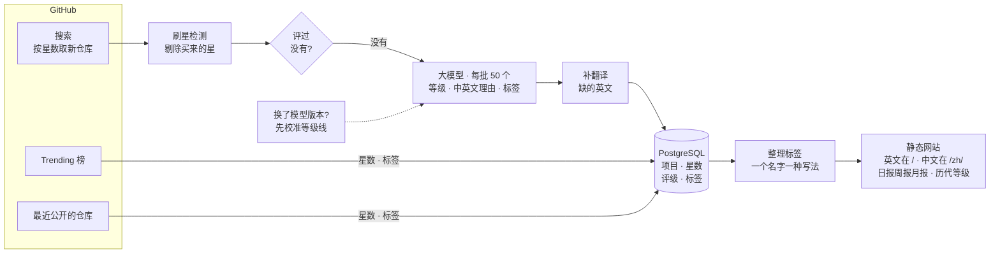
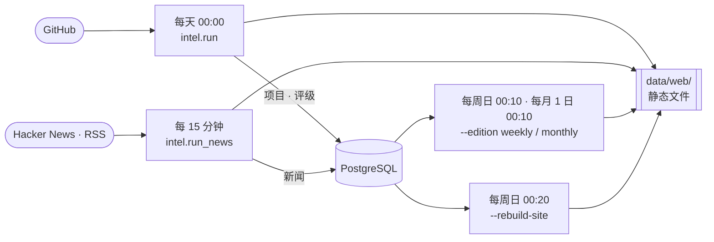

<p align="center"></p>

<h1 align="center">tierlist</h1>

<p align="center"><i>Hidden gems, rated before they trend.</i></p>

<p align="center"><a href="https://tierlist.tech">tierlist.tech</a> · <a href="./README.md">English</a> · 中文</p>

[tierlist.tech](https://tierlist.tech) 背后的引擎：每天扫描新出现的开源项目。
它在仓库诞生后的 72 小时内把它们找出来，赶在各大热榜收录之前，交给大模型逐个评级，
再生成一个静态网站，按日报、周报、月报发布。

从 2026-08-23 开始收录，此后每一期都保留在归档里，随时可以翻看。

评级用的模型是 **DeepSeek V4.1 Flash**，直接调用 DeepSeek 官方 API（模型名
`deepseek-flash`）。每个分数都记下了是哪个模型版本打的，换模型时数据里看得出来，
新版本也会有自己的等级线（见下面第 3 步）。换成其他兼容 OpenAI 接口的服务也可以，
做法见 [docs/self-hosting.md](./docs/self-hosting.md)。

## 怎么运作

每日任务从 GitHub 到网页的全过程：



1. **抓取。** GitHub 搜索按星数返回新仓库。GitHub Trending 榜和最近公开的仓库只记录星数变化并打上
   主题标签，用来做涨星榜，不参与评级。每次扫描都会给每个项目记一次星数快照。
2. **过滤。** 调用大模型之前只跑一条免费规则：剔除刷星批次（同一批几分钟内创建、
   星数一模一样的仓库）。其余新仓库全部送去评级。
3. **换模型时先校准。** 等级线按模型版本分开记。库里没见过的新版本，会先把最近 30 天的仓库
   另外重评一遍（不影响已发布的分数），按同样的百分位定出它的等级线，让每个等级的比例保持不变。
4. **评级。** 大模型把当天还没评过的仓库每 50 个一批评完。评分标准写在
   `intel/rubrics/dev_tools.yaml`：四个维度打分，再给一句中英文理由；加权分换算成 S 到 D 的等级，
   网站上只公开等级，不公开分数。主题标签从 `intel/rubrics/tags.yaml` 的固定词表里选。
5. **补翻译。** 模型漏写英文的理由，以及作者用中文、日文、韩文或俄文写的仓库简介，
   会补一句英文，让英文站读起来全是英文。
6. **整理标签。** 同义词合并成一个标签，同一个名字的不同写法（`marvelrivals`、`marvel-rivals`）
   合并成一种。
7. **发布。** `intel/deliver/` 生成静态网站（英文在根目录，中文在 `/zh/`，含日报周报月报、历代等级、
   标签页、搜索、归档、Atom 订阅源、sitemap），另外写一份当天的 markdown 简报。

四个定时任务共用一个数据库和一个输出目录：



定时任务里只有每日任务会调用大模型。周报和月报直接用库里已有的评级生成；重建任务用当前模板
把所有往期页面重新生成一遍；新闻任务只读 Hacker News 和 RSS，不评级。时间都是 UTC。

## 运行

需要 Python 3.12 和 PostgreSQL。完整的安装说明见
[docs/self-hosting.md](./docs/self-hosting.md)（英文）：接哪个模型、在哪里设置，怎么改评级口味，
定时任务，以及怎么把输出挂到网上。AI 编程助手先读 [AGENTS.md](./AGENTS.md)；Claude Code 可以用
`.claude/skills/` 里的 `/tierlist-daily` skill 跑每日任务。

```bash
python -m venv .venv
.venv/bin/pip install -e '.[dev]'
cp .env.example .env   # 然后填入 TIERLIST_PG_DSN、GITHUB_TOKEN 和模型 key
```

| 命令 | 作用 |
|---|---|
| `python -m intel.run --vertical dev_tools` | 每日任务：抓取、过滤、评级、入库、生成网站、推送 |
| `python -m intel.run --edition weekly` | 周报：直接用库里的数据生成，不抓取，不调用大模型 |
| `python -m intel.run --edition monthly` | 月报，同周报 |
| `python -m intel.run --rebuild-site` | 用当前模板重新生成所有往期页面 |
| `python -m intel.run --date YYYY-MM-DD` | 把那天还没评的项目从库里补评，并重新生成那一期 |
| `python -m intel.run --date YYYY-MM-DD --rescore` | 把那天的项目全部重新评一遍，包括已经评过的 |
| `python -m intel.run_news` | 刷新新闻页 |
| `python -m intel.run --no-deliver` | 只扫描并打印报告，不生成文件、不推送 |

tierlist.tech 用的定时表（UTC）：

```
0 0 * * *     python -m intel.run --vertical dev_tools
10 0 * * 0    python -m intel.run --vertical dev_tools --edition weekly
10 0 1 * *    python -m intel.run --vertical dev_tools --edition monthly
20 0 * * 0    python -m intel.run --rebuild-site
*/15 * * * *  python -m intel.run_news
```

输出是 `data/web/`（或 `TIERLIST_WEB_DIR` 指定的目录）下的普通静态文件，任何 web 服务器都能直接挂。

## 测试

```bash
.venv/bin/python -m pytest
.venv/bin/ruff check .
```

测试全部离线运行，不需要 key，也不需要数据库。

## 许可证

MIT，见 [LICENSE](./LICENSE)。
